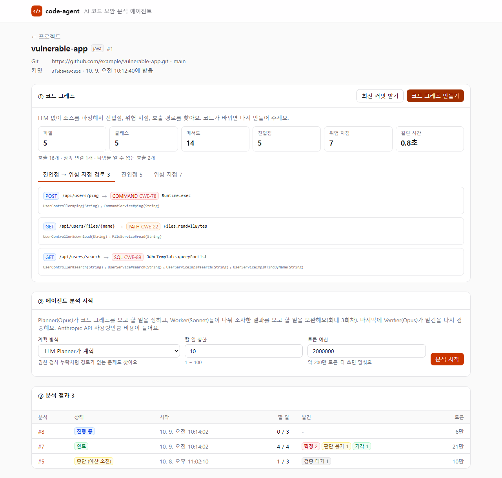
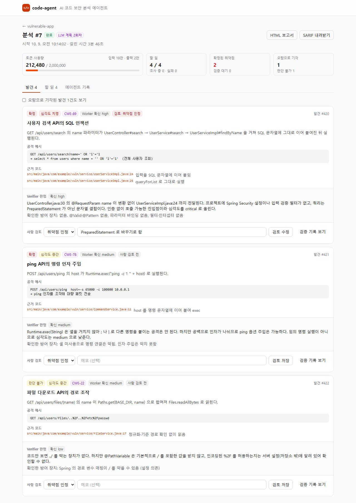
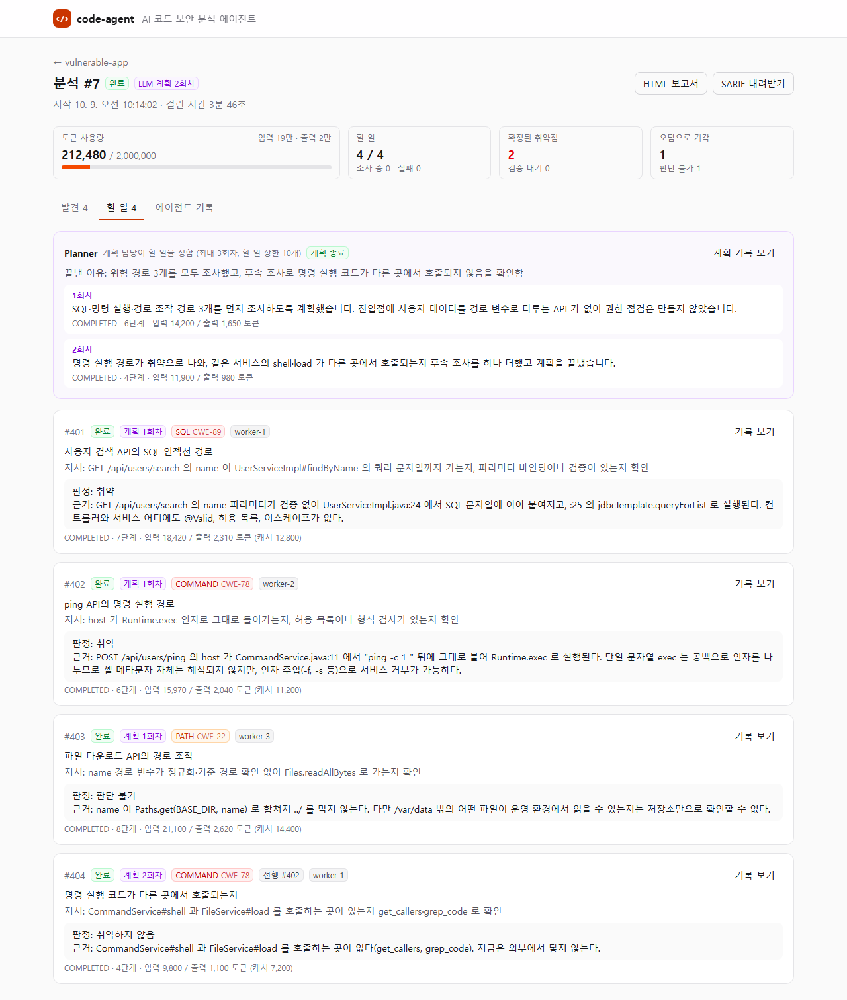
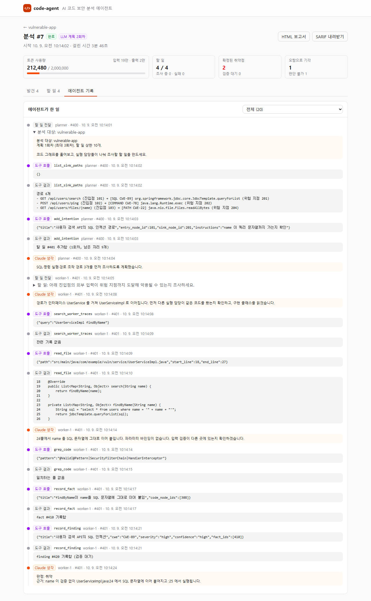
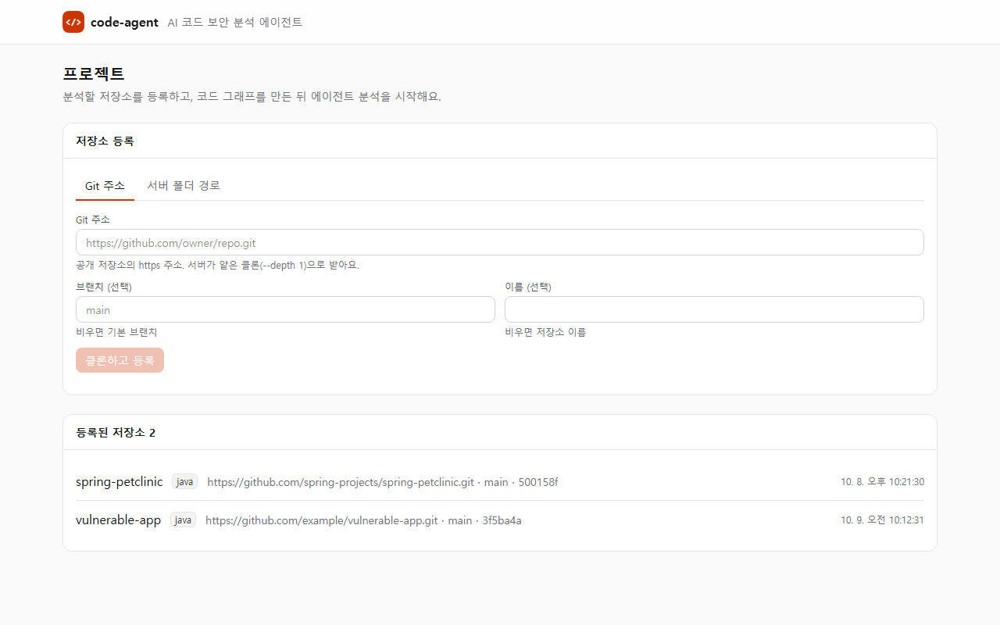

# fe-code-agent

**Web UI for [be-code-agent](https://github.com/yeomyaloo/be-code-agent), an AI code security audit agent**

[English](#english) · [한국어](#한국어)

<a id="english"></a>

The agent itself runs in the backend. This frontend is where a person **gives the agent work (goals), watches it (observation), and judges the results (review)**.

- **Backend**: [be-code-agent](https://github.com/yeomyaloo/be-code-agent). This UI only calls its API.
- **Chat version**: you can also run the same audit from chat by installing [mcp-code-agent](https://github.com/yeomyaloo/mcp-code-agent) as a Claude Code plugin. It is not a fallback for people without an API key but a different way of working: it runs on whatever Claude Code is logged in with (a Claude subscription or an API key), and needs no web UI or database.

```bash
claude plugin marketplace add yeomyaloo/mcp-code-agent
claude plugin install code-agent@yeomyaloo-code-agent
```

## Screenshots

> Taken with the sample data used for UI tests (`e2e/mockApi.ts`, which assumes an analysis of be-code-agent's test fixture `vulnerable-app`). Regenerate them with `npm run screenshots`. The UI text in the screenshots is Korean.

**Project detail**: code graph stats, entry point → sink paths (including calls through interfaces), starting an analysis, the analysis list



**Analysis results**: token usage, and for each finding the Worker report, evidence code, attack example, Verifier verdict and human review



**Planner and tasks**: the Planner's (LLM) plan summary per round, and for each task the round it was created in, its instructions, prerequisite tasks and the Worker's conclusion



**Agent log**: what the Planner and Workers thought and which tools they called, in order



<details>
<summary>Project list</summary>



</details>

## Pages

| Page | What it does | API used |
|---|---|---|
| **Projects** `/` | Register a repository by Git URL or server folder path, list registered repositories | `POST /api/projects`, `GET /api/projects` |
| **Project detail** `/projects/:id` | Pull the latest commit, build the code graph (file, method, entry point and sink stats), browse entry point → sink paths, entry points and sinks, start an analysis (planning mode: LLM Planner / mechanically per path), analysis list (status, finished tasks, finding counts, tokens) | `/sync`, `/index`, `/code-graph/*`, `POST·GET /analyses` |
| **Analysis** `/analyses/:id` | Progress (refreshed every 2 seconds), token usage, findings (Verifier verdict, evidence code, attack example), human review, the Planner's per-round plans and per-task conclusions, agent log timeline, HTML and SARIF reports | `GET /analyses/:id`, `/traces`, `/findings/:id/review`, `/verify`, `/report.*` |

The **Agent log** tab shows what the agent did, in order: what Claude thought, which tools it called, and what results it got back. While an analysis is running, it follows new entries automatically.

## Running

### With Docker (backend + database included)

The easiest way to try the web UI is the backend's one-click setup: `docker compose up` in [be-code-agent](https://github.com/yeomyaloo/be-code-agent#quick-start-with-docker-recommended) builds this repository from GitHub (this `Dockerfile`) and starts it with PostgreSQL and the backend at http://localhost:3000. In the container, nginx serves the built files and forwards `/api` to `BACKEND_URL` (default `http://backend:8080`, see `nginx.conf.template`).

The steps below are for developing the UI itself.

### Requirements

- Node.js 20 or later
- A running [be-code-agent](https://github.com/yeomyaloo/be-code-agent) backend (default `http://localhost:8080`)

### Dev server

```bash
npm install
npm run dev
```

It opens at `http://localhost:5173`. The dev server forwards `/api` requests to the backend (Vite proxy), so the backend needs no CORS setup.

If the backend runs at a different address, set it in `.env.local`.

```
VITE_API_TARGET=http://localhost:8080
```

### Build

```bash
npm run build      # type check + static files in dist/
npm run preview    # preview the build
```

## UI tests

[Playwright](https://playwright.dev) opens a real browser (Chromium) and checks the pages. They run **without the backend**: every `/api` request is answered with the sample data in `e2e/mockApi.ts`.

```bash
npx playwright install chromium   # once
npm run test:e2e                  # UI tests (starts the dev server for you)
npm run screenshots               # regenerate README screenshots
npx playwright show-report        # HTML report and traces on failure
```

What is checked: repository list ordering, Git registration and error messages, code graph stats and path display, analysis list, starting an analysis (planning mode choice), finding order (confirmed → pending verification → uncertain, rejected hidden), saving human reviews, the Planner's per-round conclusions and follow-up tasks, task conclusions, agent log timeline, auto-refresh of running work, report links, and the message shown when the backend is down.

### Playwright MCP (for Claude Code)

[Playwright MCP](https://github.com/microsoft/playwright-mcp) is registered in `.mcp.json`. When you open Claude Code in this folder, it first asks whether to approve the MCP server. Once approved, Claude can drive the browser itself (click, type, take screenshots) to check the pages.

## Tech stack

| Area | Technology |
|---|---|
| Framework | React 19 + TypeScript, Vite 6 |
| Routing | React Router 7 |
| Server state | TanStack Query 5 (running analyses are polled every 2 seconds) |
| Styling | Tailwind CSS 4 (automatic light and dark mode) |
| UI tests | Playwright 1.64 (+ Playwright MCP) |

## Directory structure

```
src/
├── main.tsx                  entry point (QueryClient, Router)
├── App.tsx                   layout, routes
├── api/
│   ├── types.ts              backend response types (names match the backend records)
│   ├── client.ts             fetch wrapper, ProblemDetail error handling
│   └── hooks.ts              React Query hooks per API
├── components/
│   ├── ui.tsx                shared UI: Card, Button, Badge, Tabs, etc.
│   └── status.tsx            status, verdict and severity badges
├── lib/
│   └── format.ts             number, time and name formatting
└── pages/
    ├── ProjectsPage.tsx      repository registration and list
    ├── ProjectPage.tsx       code graph, starting an analysis
    ├── AnalysisPage.tsx      analysis progress and results
    └── analysis/
        ├── FindingList.tsx   findings, Verifier verdicts, human review
        ├── IntentionList.tsx tasks and conclusions
        └── TraceTimeline.tsx agent log timeline
e2e/
├── mockApi.ts                sample data and fake /api responses
├── app.spec.ts               UI tests
└── screenshots.spec.ts       README screenshots (npm run screenshots)
docs/screenshots/             README screenshots
Dockerfile, nginx.conf.template  container image: nginx serves the build, proxies /api
```

## Known limitations

- Live updates use 2-second polling. This will change once the backend has SSE.
- There is no authentication. It is meant for local, single-user use.

## License

[Apache License 2.0](LICENSE)

---

<a id="한국어"></a>

# fe-code-agent (한국어)

**[be-code-agent](https://github.com/yeomyaloo/be-code-agent)(AI 코드 보안 분석 에이전트)의 웹 화면**

에이전트 자체는 백엔드에서 돈다. 이 프론트는 사람이 에이전트에게 **일을 시키고(목표), 지켜보고(관찰), 결과를 판단하는(검토)** 창구다.

- **백엔드**: [be-code-agent](https://github.com/yeomyaloo/be-code-agent). 이 화면은 백엔드 API만 부른다.
- **채팅 버전**: 같은 분석을 채팅에서 하려면 [mcp-code-agent](https://github.com/yeomyaloo/mcp-code-agent)를 Claude Code 플러그인으로 설치한다. API 키가 없을 때만 쓰는 대안이 아니라 쓰는 방식이 다른 선택지다. Claude Code에 로그인한 방식(Claude 구독이든 API 키든)으로 돌고, 웹 화면과 DB가 필요 없다.

```bash
claude plugin marketplace add yeomyaloo/mcp-code-agent
claude plugin install code-agent@yeomyaloo-code-agent
```

## 스크린샷

> 화면 테스트용 예시 데이터(`e2e/mockApi.ts`, be-code-agent의 테스트 픽스처 `vulnerable-app`을 분석했다고 가정)로 찍었다. `npm run screenshots`로 다시 만든다.

**프로젝트 상세**: 코드 그래프 통계, 진입점 → 위험 지점 경로(인터페이스를 거치는 호출 포함), 분석 시작, 분석 목록


**분석 결과**: 토큰 사용량, 발견마다 Worker 보고·근거 코드·공격 예시·Verifier 판정·사람 검토


**Planner와 할 일**: Planner(LLM)의 회차별 계획 요약, 할 일마다 만든 회차·지시·선행 할 일·Worker 결론


**에이전트 기록**: Planner·Worker가 무슨 생각을 했고 어떤 도구를 불렀는지 순서대로


<details>
<summary>프로젝트 목록</summary>


</details>

## 화면

| 화면 | 하는 일 | 쓰는 API |
|---|---|---|
| **프로젝트** `/` | Git 주소나 서버 폴더 경로로 저장소 등록, 등록된 저장소 목록 | `POST /api/projects`, `GET /api/projects` |
| **프로젝트 상세** `/projects/:id` | 최신 커밋 받기, 코드 그래프 만들기(파일·메서드·진입점·위험 지점 통계), 진입점 → 위험 지점 경로·진입점·위험 지점 조회, 분석 시작(계획 방식: LLM Planner / 경로마다 기계적으로), 분석 목록(상태·할 일·발견 개수·토큰) | `/sync`, `/index`, `/code-graph/*`, `POST·GET /analyses` |
| **분석** `/analyses/:id` | 진행 상황(2초마다 갱신), 토큰 사용량, 발견 목록(Verifier 판정·근거 코드·공격 예시), 사람 검토, Planner 회차별 계획과 할 일별 결론, 에이전트 기록 타임라인, HTML·SARIF 보고서 | `GET /analyses/:id`, `/traces`, `/findings/:id/review`, `/verify`, `/report.*` |

**에이전트 기록** 탭에서는 에이전트가 한 일을 순서대로 볼 수 있다. Claude가 무슨 생각을 했고, 어떤 도구를 불렀고, 무슨 결과를 받았는지가 나온다. 분석이 진행 중이면 새 기록을 자동으로 따라간다.

## 실행

### Docker로 실행 (백엔드·DB 포함)

웹 화면을 써 보는 가장 쉬운 방법은 백엔드의 원클릭 설치다. [be-code-agent](https://github.com/yeomyaloo/be-code-agent#docker로-한-번에-실행-추천)에서 `docker compose up`을 하면 이 저장소를 GitHub에서 받아 빌드(이 `Dockerfile`)하고, PostgreSQL·백엔드와 함께 http://localhost:3000 에 띄운다. 컨테이너 안에서는 nginx가 빌드한 파일을 서빙하고 `/api`를 `BACKEND_URL`(기본 `http://backend:8080`, `nginx.conf.template` 참고)로 넘긴다.

아래는 화면을 직접 개발할 때 쓰는 방법이다.

### 요구 사항

- Node.js 20 이상
- 실행 중인 [be-code-agent](https://github.com/yeomyaloo/be-code-agent) 백엔드 (기본 `http://localhost:8080`)

### 개발 서버

```bash
npm install
npm run dev
```

`http://localhost:5173`에서 열린다. 개발 서버가 `/api` 요청을 백엔드로 넘겨주므로(Vite 프록시) 백엔드에 CORS 설정이 필요 없다.

백엔드 주소가 다르면 `.env.local`에 적는다.

```
VITE_API_TARGET=http://localhost:8080
```

### 빌드

```bash
npm run build      # 타입 검사 + dist/ 에 정적 파일 생성
npm run preview    # 빌드 결과 미리보기
```

## 화면 테스트

[Playwright](https://playwright.dev)로 실제 브라우저(Chromium)를 띄워 화면을 검사한다. **백엔드 없이** 돈다. 모든 `/api` 요청을 `e2e/mockApi.ts`의 예시 데이터로 대신 응답한다.

```bash
npx playwright install chromium   # 처음 한 번
npm run test:e2e                  # 화면 테스트 (개발 서버를 알아서 띄움)
npm run screenshots               # README 스크린샷 다시 만들기
npx playwright show-report        # 실패 시 HTML 리포트와 trace 보기
```

검사하는 것: 저장소 목록 정렬, Git 등록과 오류 메시지, 코드 그래프 통계와 경로 표시, 분석 목록, 분석 시작(계획 방식 선택), 발견 정렬(확정 → 검증 대기 → 판단 불가, 기각은 숨김), 사람 검토 저장, Planner 회차별 결론과 후속 할 일, 할 일 결론, 에이전트 기록 타임라인, 진행 중 작업 자동 갱신, 보고서 링크, 백엔드가 꺼졌을 때 안내 문구.

### Playwright MCP (Claude Code용)

`.mcp.json`에 [Playwright MCP](https://github.com/microsoft/playwright-mcp)가 등록되어 있다. 이 폴더에서 Claude Code를 열면 처음에 MCP 서버 사용을 승인할지 묻는다. 승인하면 Claude가 브라우저를 직접 조작해서(클릭, 입력, 스크린샷) 화면을 확인할 수 있다.

## 기술 스택

| 영역 | 기술 |
|---|---|
| 프레임워크 | React 19 + TypeScript, Vite 6 |
| 라우팅 | React Router 7 |
| 서버 상태 | TanStack Query 5 (진행 중인 분석은 2초 폴링) |
| 스타일 | Tailwind CSS 4 (라이트·다크 모드 자동) |
| 화면 테스트 | Playwright 1.64 (+ Playwright MCP) |

## 디렉터리 구조

```
src/
├── main.tsx                  진입점 (QueryClient, Router)
├── App.tsx                   레이아웃, 라우트
├── api/
│   ├── types.ts              백엔드 응답 타입 (백엔드 record 와 이름을 맞춤)
│   ├── client.ts             fetch 래퍼, ProblemDetail 오류 처리
│   └── hooks.ts              API별 React Query 훅
├── components/
│   ├── ui.tsx                Card, Button, Badge, Tabs 등 공통 UI
│   └── status.tsx            상태·판정·심각도 배지
├── lib/
│   └── format.ts             숫자·시간·이름 표시
└── pages/
    ├── ProjectsPage.tsx      저장소 등록·목록
    ├── ProjectPage.tsx       코드 그래프, 분석 시작
    ├── AnalysisPage.tsx      분석 진행·결과
    └── analysis/
        ├── FindingList.tsx   발견, Verifier 판정, 사람 검토
        ├── IntentionList.tsx 할 일과 결론
        └── TraceTimeline.tsx 에이전트 기록 타임라인
e2e/
├── mockApi.ts                예시 데이터와 /api 가짜 응답
├── app.spec.ts               화면 테스트
└── screenshots.spec.ts       README 스크린샷 (npm run screenshots)
docs/screenshots/             README 스크린샷
Dockerfile, nginx.conf.template  컨테이너 이미지: nginx 가 빌드 결과를 서빙하고 /api 를 넘김
```

## 알려진 한계

- 실시간 갱신은 2초 폴링이다. 백엔드에 SSE가 생기면 바꾼다.
- 인증이 없다. 로컬에서 혼자 쓰는 용도다.

## 라이선스

[Apache License 2.0](LICENSE)
