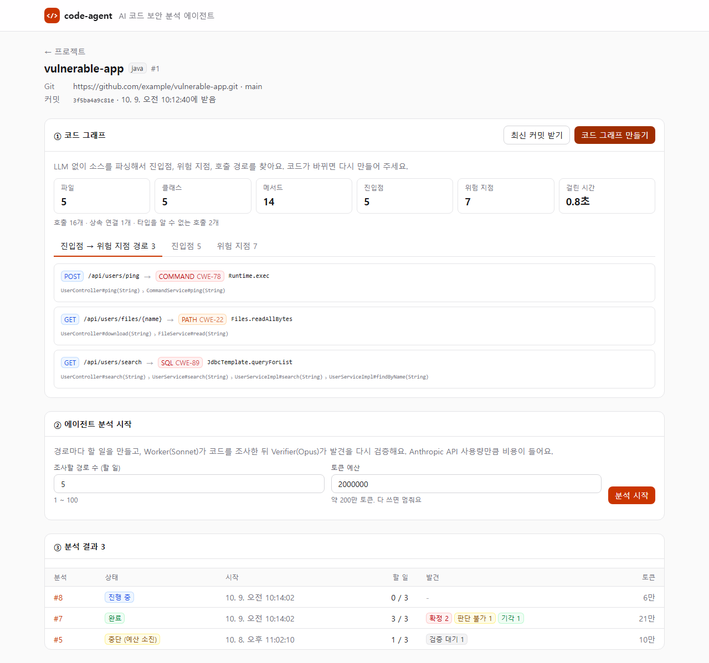
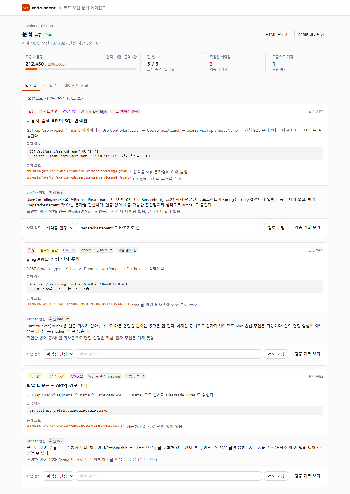
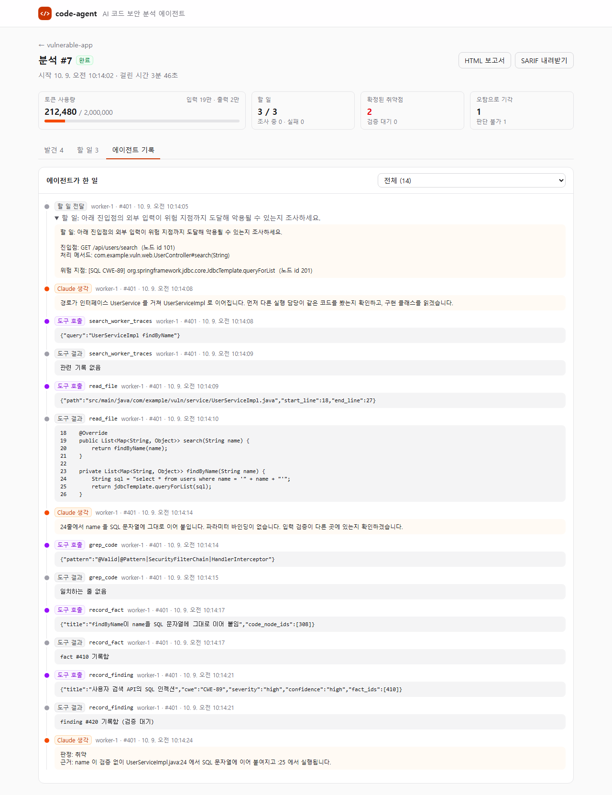
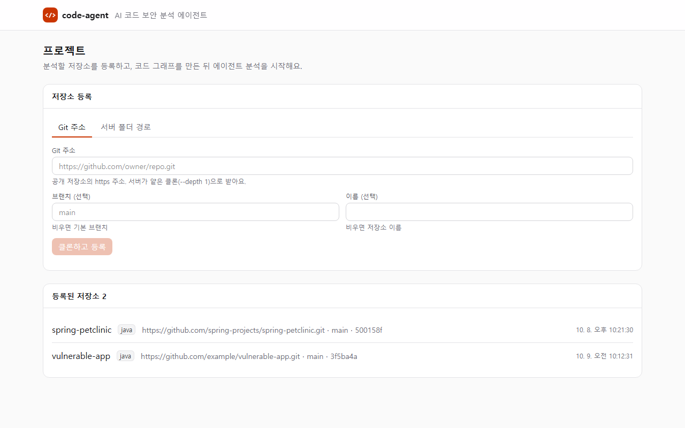

# fe-code-agent

**[be-code-agent](https://github.com/yeomyaloo/be-code-agent)(AI 코드 보안 분석 에이전트)의 웹 화면**

에이전트 자체는 백엔드에서 돈다. 이 프론트는 사람이 에이전트에게 **일을 시키고(목표), 지켜보고(관찰), 결과를 판단하는(검토)** 창구다.

## 스크린샷

> 화면 테스트용 예시 데이터(`e2e/mockApi.ts`, be-code-agent의 테스트 픽스처 `vulnerable-app`을 분석했다고 가정)로 찍었다. `npm run screenshots`로 다시 만든다.

**프로젝트 상세**: 코드 그래프 통계, 진입점 → 위험 지점 경로(인터페이스를 거치는 호출 포함), 분석 시작, 분석 목록



**분석 결과**: 토큰 사용량, 발견마다 Worker 보고·근거 코드·공격 예시·Verifier 판정·사람 검토



**에이전트 기록**: Claude가 무슨 생각을 했고 어떤 도구를 불렀는지 순서대로



<details>
<summary>프로젝트 목록</summary>



</details>

## 화면

| 화면 | 하는 일 | 쓰는 API |
|---|---|---|
| **프로젝트** `/` | Git 주소나 서버 폴더 경로로 저장소 등록, 등록된 저장소 목록 | `POST /api/projects`, `GET /api/projects` |
| **프로젝트 상세** `/projects/:id` | 최신 커밋 받기, 코드 그래프 만들기(파일·메서드·진입점·위험 지점 통계), 진입점 → 위험 지점 경로·진입점·위험 지점 조회, 분석 시작, 분석 목록(상태·할 일·발견 개수·토큰) | `/sync`, `/index`, `/code-graph/*`, `POST·GET /analyses` |
| **분석** `/analyses/:id` | 진행 상황(2초마다 갱신), 토큰 사용량, 발견 목록(Verifier 판정·근거 코드·공격 예시), 사람 검토, 할 일별 결론, 에이전트 기록 타임라인, HTML·SARIF 보고서 | `GET /analyses/:id`, `/traces`, `/findings/:id/review`, `/verify`, `/report.*` |

**에이전트 기록** 탭에서는 에이전트가 한 일을 순서대로 볼 수 있다. Claude가 무슨 생각을 했고, 어떤 도구를 불렀고, 무슨 결과를 받았는지가 나온다. 분석이 진행 중이면 새 기록을 자동으로 따라간다.

## 실행

### 요구 사항

- Node.js 20 이상
- 실행 중인 [be-code-agent](https://github.com/yeomyaloo/be-code-agent) 백엔드 (기본 `http://localhost:8080`)

### 개발 서버

```bash
npm install
npm run dev
```

`http://localhost:5173`에서 열린다. 개발 서버가 `/api` 요청을 백엔드로 넘겨주므로(Vite 프록시) 백엔드에 CORS 설정이 필요 없다.

백엔드 주소가 다르면 `.env.local`에 적는다.

```
VITE_API_TARGET=http://localhost:8080
```

### 빌드

```bash
npm run build      # 타입 검사 + dist/ 에 정적 파일 생성
npm run preview    # 빌드 결과 미리보기
```

## 화면 테스트

[Playwright](https://playwright.dev)로 실제 브라우저(Chromium)를 띄워 화면을 검사한다. **백엔드 없이** 돈다. 모든 `/api` 요청을 `e2e/mockApi.ts`의 예시 데이터로 대신 응답한다.

```bash
npx playwright install chromium   # 처음 한 번
npm run test:e2e                  # 화면 테스트 (개발 서버를 알아서 띄움)
npm run screenshots               # README 스크린샷 다시 만들기
npx playwright show-report        # 실패 시 HTML 리포트와 trace 보기
```

검사하는 것: 저장소 목록 정렬, Git 등록과 오류 메시지, 코드 그래프 통계와 경로 표시, 분석 목록, 분석 시작, 발견 정렬(확정 → 검증 대기 → 판단 불가, 기각은 숨김), 사람 검토 저장, 할 일 결론, 에이전트 기록 타임라인, 진행 중 작업 자동 갱신, 보고서 링크, 백엔드가 꺼졌을 때 안내 문구.

### Playwright MCP (Claude Code용)

`.mcp.json`에 [Playwright MCP](https://github.com/microsoft/playwright-mcp)가 등록되어 있다. 이 폴더에서 Claude Code를 열면 처음에 MCP 서버 사용을 승인할지 묻는다. 승인하면 Claude가 브라우저를 직접 조작해서(클릭, 입력, 스크린샷) 화면을 확인할 수 있다.

## 기술 스택

| 영역 | 기술 |
|---|---|
| 프레임워크 | React 19 + TypeScript, Vite 6 |
| 라우팅 | React Router 7 |
| 서버 상태 | TanStack Query 5 (진행 중인 분석은 2초 폴링) |
| 스타일 | Tailwind CSS 4 (라이트·다크 모드 자동) |
| 화면 테스트 | Playwright 1.64 (+ Playwright MCP) |

## 디렉터리 구조

```
src/
├── main.tsx                  진입점 (QueryClient, Router)
├── App.tsx                   레이아웃, 라우트
├── api/
│   ├── types.ts              백엔드 응답 타입 (백엔드 record 와 이름을 맞춤)
│   ├── client.ts             fetch 래퍼, ProblemDetail 오류 처리
│   └── hooks.ts              API별 React Query 훅
├── components/
│   ├── ui.tsx                Card, Button, Badge, Tabs 등 공통 UI
│   └── status.tsx            상태·판정·심각도 배지
├── lib/
│   └── format.ts             숫자·시간·이름 표시
└── pages/
    ├── ProjectsPage.tsx      저장소 등록·목록
    ├── ProjectPage.tsx       코드 그래프, 분석 시작
    ├── AnalysisPage.tsx      분석 진행·결과
    └── analysis/
        ├── FindingList.tsx   발견, Verifier 판정, 사람 검토
        ├── IntentionList.tsx 할 일과 결론
        └── TraceTimeline.tsx 에이전트 기록 타임라인
e2e/
├── mockApi.ts                예시 데이터와 /api 가짜 응답
├── app.spec.ts               화면 테스트
└── screenshots.spec.ts       README 스크린샷 (npm run screenshots)
docs/screenshots/             README 스크린샷
```

## 알려진 한계

- 실시간 갱신은 2초 폴링이다. 백엔드에 SSE가 생기면 바꾼다.
- 인증이 없다. 로컬에서 혼자 쓰는 용도다.

## 라이선스

[Apache License 2.0](LICENSE)
